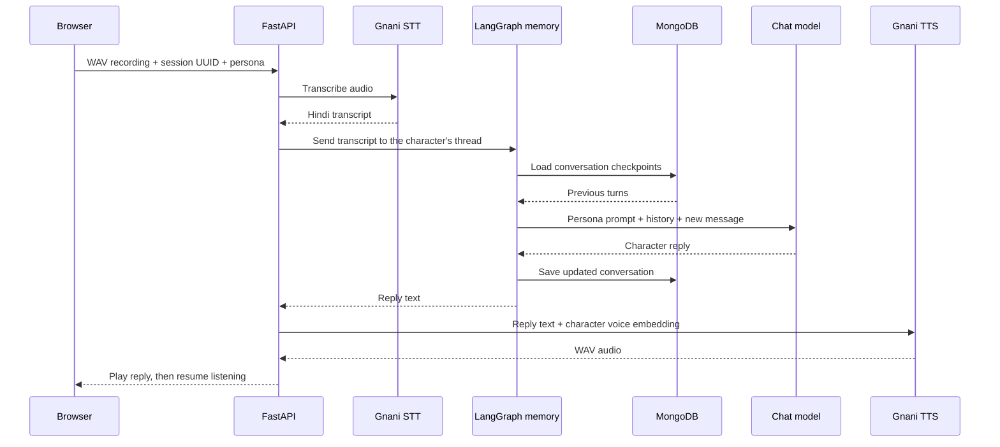

<div align="center">


### Familiar faces. Unscripted conversations.

**Hindi-first voice chat · Character-inspired voices · Conversation memory**

[Get started](#get-started) · [Meet the cast](#meet-the-cast) · [How it works](#how-it-works) · [API](#api) · [LICENSE](#license)

</div>

---

Talk Toon is a voice-based chat app that lets you have casual conversations with familiar characters like Jack Sparrow, Shinchan, and Doraemon. Choose a character, and start talking.

Each personality is designed to **chat like a character, not respond like an assistant**. Replies reflect the character’s humor, attitude, and warmth while staying short and natural. Conversations are primarily in Hindi, with everyday English words mixed (typical Hinglish) in wherever they feel comfortable—more like chatting with a friend than receiving formal answers, tutorials, or unsolicited advice.

## What makes it Talk Toon

- **A cast with personality.** Ten persona prompts shape each character's reactions, humor, and conversational style.
- **Speak, pause, listen.** Voice activity detection sends your turn after a short silence, without pressing a button for every message.
- **Voices to match.** Each character has a stored voice embedding used for speech synthesis.
- **A conversation that remembers.** MongoDB-backed memory keeps earlier turns available, separately for each session and character.
- **A clear listening experience.** The waveform follows your microphone while recording and the reply during playback. The microphone stays off while a turn is processed or played.
- **Stop means stop.** Stop discards unfinished capture, aborts the browser request, stops playback, and prevents automatic listening from restarting.

## Meet the cast

| Character | API persona ID |
| --- | --- |
| Jack Sparrow | `jack-sparrow` |
| Shinchan | `shinchan` |
| Doraemon | `doraemon` |
| Optimus Prime | `optimus-prime` |
| Deadpool | `deadpool` |
| Little Krishna | `little-krishna` |
| Nobita | `nobita` |
| Amrish Puri-inspired persona | `amrish-puri` |
| Patlu | `patlu` |
| Jack — Oggy and the Cockroaches | `jack` |

## Get started

### Prerequisites

- **Python 3.12 or newer** and [uv](https://docs.astral.sh/uv/getting-started/installation/).
- **Node.js 22.12 or newer** and npm.
- A **Gnani / Vachana API key** with access to transcription and voice-cloning synthesis.
- An **OpenAI-compatible chat-completions endpoint**, model, and API key.
- A running **MongoDB** instance, local or hosted, reachable by the backend.
- A microphone and a browser with Web Audio and AudioWorklet support.

### 1. Install dependencies

```bash
git clone https://github.com/iam-tsr/talk-star.git
cd talk-star
uv sync
npm ci
```

Run the following commands from the repository root.

### 2. Configure the backend

Create a `.env` file in the repository root:

```bash
cp .env.example .env
```

The LLM values above use OpenAI as an example; set the URL, model, and key for your chosen compatible provider. For a hosted MongoDB deployment, replace `MONGO_URI` with its connection string and allow the backend to connect.

### 3. Start the API

```bash
uv run uvicorn src.main:app --host 127.0.0.1 --port 8000
```

### 4. Start the browser app

In a second terminal:

```bash
npm run dev
```

## How it works



The frontend is plain JavaScript built with Vite. The backend uses FastAPI, Gnani Prisma v3.0 for Hindi transcription, an OpenAI-compatible client for generation, LangGraph with MongoDB checkpoints for memory, and Gnani `vachana-vc-v1` for synthesis.

This is a turn-based voice pipeline, not a streaming or simultaneous-listening conversation. Transcription is currently configured for `hi-IN`.

## API

### `GET /health`

```bash
curl --fail http://127.0.0.1:8000/health
```

Returns `{"status":"ok"}`. This checks server liveness, not MongoDB connectivity, provider credentials, or provider availability.

### `POST /talk`

Send a multipart form and receive a WAV reply:

```bash
# Generate once, then reuse this ID for subsequent turns.
SESSION_ID=$(uv run python -c 'from uuid import uuid4; print(uuid4())')

curl --fail-with-body http://127.0.0.1:8000/talk \
  -F 'audio_file=@recording.wav' \
  -F "session_id=$SESSION_ID" \
  -F 'persona=jack-sparrow' \
  --output reply.wav
```

| Field | Required | Description |
| --- | --- | --- |
| `audio_file` | Yes | Audio recording to transcribe. The browser sends mono 16-bit PCM WAV. |
| `session_id` | Yes | Valid UUID. Reuse it to continue the same session. |
| `persona` | No | Character ID from the cast table. Defaults to `jack-sparrow`. |

A successful response is `200` with `Content-Type: audio/wav`.

- **`422`** — missing upload, missing or invalid UUID, unknown persona, or an empty transcript.
- **`502`** — a speech, LLM, or MongoDB operation fails, or generation returns an empty reply.

Uploaded audio is temporarily stored for transcription and removed afterward, including on failure. Blocking provider calls run in FastAPI's worker thread pool. Aborting a browser request does not guarantee cancellation of an already-running provider operation or memory write.

### Project map

| Path | Purpose |
| --- | --- |
| [`web/`](web/) | Character picker, recording lifecycle, playback, and waveform UI. |
| [`web/recorder.js`](web/recorder.js) | Microphone capture and WAV encoding. |
| [`web/pcm-worklet.js`](web/pcm-worklet.js) | AudioWorklet processing and speech/silence detection. |
| [`src/main.py`](src/main.py) | Health and audio-conversation endpoints. |
| [`src/stt.py`](src/stt.py) / [`src/tts.py`](src/tts.py) | Gnani transcription and voice synthesis. |
| [`src/gen.py`](src/gen.py) | OpenAI-compatible chat-completions client. |
| [`src/memory.py`](src/memory.py) | Persistent conversation graph and history helpers. |
| [`src/persona/`](src/persona/) | Character identities, tone, language, and safety boundaries. |
| [`src/voice-embed/`](src/voice-embed/) | Stored voice embeddings selected by persona ID. |
| [`src/config/`](src/config/) | Environment-backed backend settings. |
| [`tests/`](tests/) | API and memory regressions, plus manual provider checks. |

## Troubleshooting

| Symptom | What to check |
| --- | --- |
| Microphone permission is denied | Allow microphone access in browser settings, then start again. |
| Recording is unavailable on another device | Use HTTPS; the localhost exception does not apply to a plain HTTP LAN address. |
| The page shows **API offline** | Start FastAPI on port `8000` and verify `/health`. |
| `/health` works but a conversation fails | Check backend logs, provider credentials/model access, and MongoDB connectivity and permissions. Liveness does not verify these dependencies. |
| A turn sends too early or background noise triggers recording | Reduce background noise, use headphones, and speak without long pauses. |
| A character does not remember another character's conversation | Expected: histories are isolated by persona as well as session UUID. |

## Privacy and responsible use

Audio is sent to Gnani for transcription. Conversation text, including previous turns, is sent to the configured LLM provider; generated reply text is sent to Gnani for synthesis. Conversation checkpoints are stored in your MongoDB database. Do not treat this as an offline or ephemeral chat system.

These are AI-generated, character-inspired conversations, not official performances or statements by the characters' creators or actors. Use voice samples, embeddings, and character assets only where you have the necessary rights and permissions.

## License

Copyright 2026 TSR.

Talk Toon's original source code and documentation are licensed under the
[Apache License, Version 2.0](LICENSE).

This license does not grant rights to third-party characters, trademarks,
artwork, voice samples, or voice embeddings. Those materials remain subject
to author rights and any applicable licenses or permissions.

---

Built by [TSR](https://github.com/iam-tsr)
